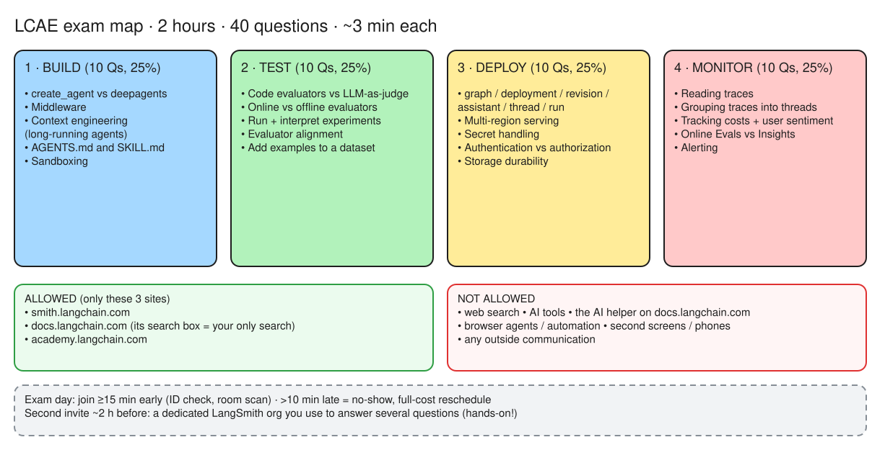
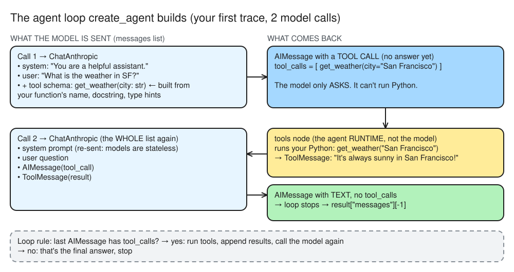

# LCAE Day 1: Rules of the game + your first trace

## Bets (placed with docs closed)

| Bet | Question | My guess | Actual | Result |
|---|---|---|---|---|
| A | Minutes before start to join the proctor session | 15 | 15 ([exam guide](https://pub-dffa5f25c09c49488e245c43fcd4d0b5.r2.dev/exam_guide.pdf), Exam-day logistics) | win |
| B | Env vars that send traces to LangSmith | `LANGSMITH_TRACING` + `LANGSMITH_API_KEY` | same ([quickstart: Trace agent calls](https://docs.langchain.com/oss/python/langchain/quickstart#trace-agent-calls)) | win |

## Mission 1: the exam's rulebook

*Editable source: [w01d01-m1-exam-map.excalidraw](../docs/diagrams/w01d01-m1-exam-map.excalidraw)*

Source: [LCAE exam guide (PDF)](https://pub-dffa5f25c09c49488e245c43fcd4d0b5.r2.dev/exam_guide.pdf), checked 2026-10-08.

- 2 hours, 4 sections × 10 questions (25% each) = 40 questions, so about 3 minutes a question.
- Join at least **15 minutes** early. More than 10 minutes late = no-show, full-cost reschedule.
- Second invite about 2 h before the start: a **dedicated LangSmith org**, used to answer several questions. Some questions are hands-on in the UI.
- Allowed: smith.langchain.com, docs.langchain.com, academy.langchain.com. Banned: web search, AI tools, **the docs site's own AI helper**, browser agents, second screens, outside communication.

## Mission 2: first trace

- Lab: uv project in `langchain-labs` (`langchain` 1.4.3, `langchain-anthropic` 1.7.5, `python-dotenv`). Keys live in `mosherif-labs/.env` (outside any repo); `load_dotenv()` finds it by searching up from the script's folder.
- Tracing is on with `LANGSMITH_TRACING=true` + `LANGSMITH_API_KEY`; no code changes ([quickstart: Trace agent calls](https://docs.langchain.com/oss/python/langchain/quickstart#trace-agent-calls)).
- **First trace** [https://smith.langchain.com/public/fa42f7b1-d7d6-4230-91e1-1699ffac8874/r/01a11b7c-2154-7892-9ad2-3b08d423b7bc](https://smith.langchain.com/public/fa42f7b1-d7d6-4230-91e1-1699ffac8874/r/01a11b7c-2154-7892-9ad2-3b08d423b7bc)
- Prediction before opening it: **2** model calls.
- Actual: **2** model calls (win). 1,302 tokens, ≈$0.005, 4.7 s.

*Editable source: [w01d01-m2-agent-loop.excalidraw](../docs/diagrams/w01d01-m2-agent-loop.excalidraw)*

### Lessons learnt
- My first read: "call 1 was for the system instructions". **Wrong.** Call 1's output is an `AIMessage` with a **tool call** (`get_weather(city="San Francisco")`), not an answer.
- The model never runs the tool. The agent runtime (LangGraph `tools` node) runs the Python function and appends a `ToolMessage`.
- Every model call gets the **whole** message list again, system prompt included: the model is stateless.
- The loop stops when an `AIMessage` comes back with no `tool_calls`.

### Check: two cities ("What's the weather in SF and in Paris?")
- Prediction: 2 model calls, 2 tool calls. **Actual: same (win).** [Trace](https://smith.langchain.com/public/936a53cb-dcce-4d3a-97a3-c245a99d3bfe/r/01a11bbc-a6c9-7511-85e2-7f529695899d): 1,490 tokens, ≈$0.006, 4.5 s.
- Call 1 returned **one** `AIMessage` with **two** `tool_calls` (parallel tool calling). The runtime ran both as separate tool runs, then call 2 answered.
- That `AIMessage` had text ("I'll check both…") **and** tool calls. Only a message with no `tool_calls` ends the loop.
- The model, not my code, decides parallel (2 calls) vs one-at-a-time (3 calls).

## Mission 3: Academy, Introduction to LangChain (Python), Module 1

- **Memory (win):** an agent remembers earlier `invoke()` calls only with a **checkpointer** in `create_agent(...)` **and** a `thread_id` in the invoke config (`{"configurable": {"thread_id": ...}}`). Without both, each call starts from zero. Ties to Deploy (*thread*) and Monitor (*grouping traces into threads*).
- **Tools (miss, see gap log):** name + docstring + type hints define a tool. `@tool` is optional ([Tools: Basic tool definition](https://docs.langchain.com/oss/python/langchain/tools#basic-tool-definition)).

## Mission 4: checklist
- Starting colours in [`objectives.md`](objectives.md): 1 green (reading traces), 2 amber (`create_agent` vs `deepagents`, AGENTS.md/SKILL.md), 17 red.
- [`gap-log.md`](gap-log.md) started (1 entry: what makes a tool).

## Reflection
- Rule that surprised me most: **the AI helper on docs.langchain.com is banned.** Only the plain docs search on exam day, so practise finding pages by hand (side quest: docs-search drill).
- Domain I expect to be hardest: **Deploy.**
